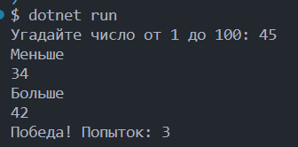
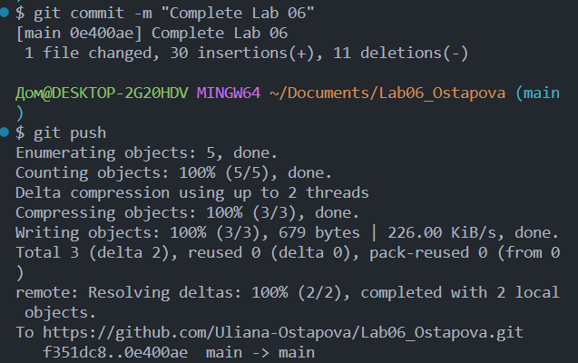

# Практическая работа №6

**ФИО:** Остапова Ульяна Александровна 
**Группа:** ИСП-241
**Дата:** 17.10.26

## Что изучено

- Отличие цикла `while` от `do while`. `while` используется, когда неизвестно, сколько раз нужно повторить, а условие проверяется до выполнения тела. В `do while` условие повторяется после тела, поэтому выполнится минимум один раз.

- Цикл `for` который используется, когда количество повторений известно заранее. У `for` три части в скобках, например:
    -	`int i = 1` — начальное значение счётчика; 
    -	`i <= 10` — условие: пока оно верно, цикл работает; 
    -	`i++` — что делать после каждого шага (увеличить i на 1, но также можно уменьшить: `i--`).

- С помощью `break` можно досрочно выйти из цикла или оператора `switch`. `continue` - пропускает оставшуюся часть текущего шага и переходит к следующему.

